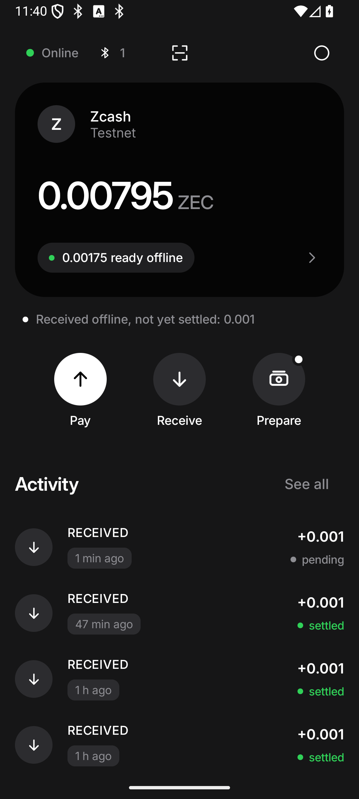
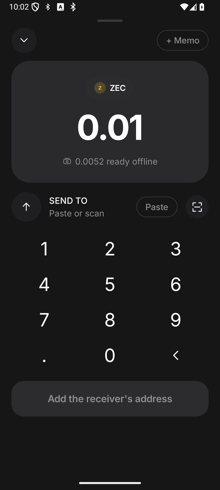
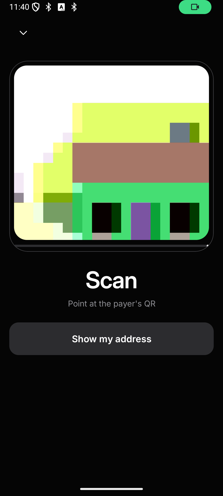
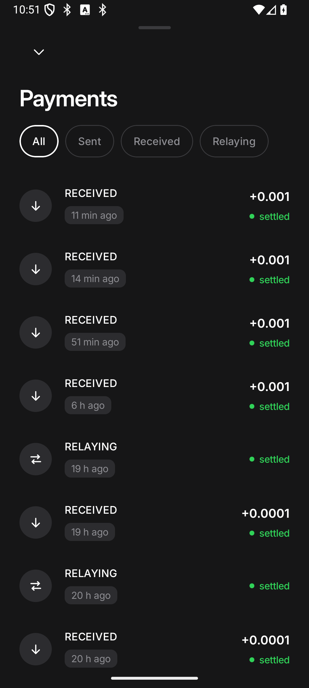
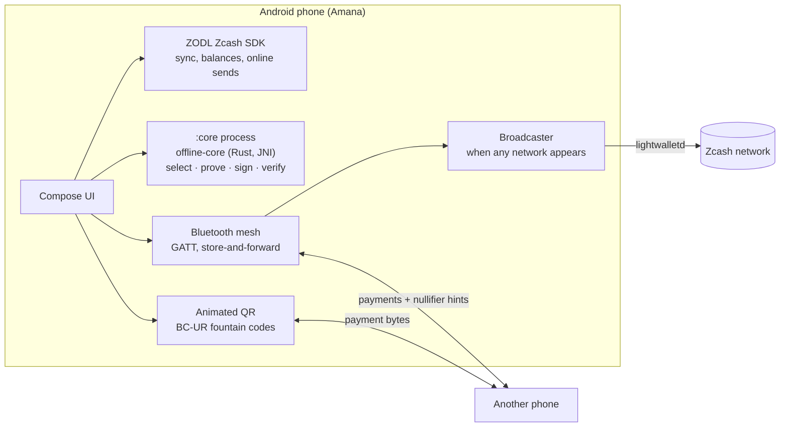

<p align="center"></p>

<h1 align="center">Amana</h1>

<p align="center"><b>Private Zcash payments that work with no network at all.</b><br>
Sign a shielded payment offline, hand it over by QR, let phones nearby carry it over Bluetooth,
and it settles when any phone reaches the network.</p>

<p align="center">ZECATHON 2026 · Track 01: Shielded Payments · Android · Zcash testnet</p>

---

*amana*: trust, something held in good faith for someone. One word across Arabic, Swahili, Hausa and Malay.

> **Try it on your phone:** download `amana-testnet.apk` from the [latest release](../../releases/latest) and
> follow **[TRY_IT.md](TRY_IT.md)**: free testnet coins, offline cash, a payment with no network, settled.

## Why

Digital money stops the moment the network does, and the network is exactly what fails first.

| | | Source |
|---|---|---|
| **666 million** | people live without electricity | IEA, IRENA, UN, World Bank, WHO: *Tracking SDG7 2025* (2023 data) |
| **~300 million** | live outside mobile broadband coverage | GSMA, *State of Mobile Internet Connectivity 2025* |
| **296** | internet shutdowns in 2024, in 54 countries | Access Now, *#KeepItOn* 2024 report |
| **1.3 billion** | adults have no account at all, bank or mobile money | World Bank, *Global Findex 2025* |

Cash still works in a blackout, but it can be lost or stolen and it doesn't travel. Mobile money and cards need
a live connection at the moment you pay, and they record who paid whom. Amana keeps what cash gets right
(it works anywhere, and it's private) and adds what cash lacks (it's digital, it settles, and it can travel).

## What it does

1. **Prepare** (with signal). Set aside offline cash, like drawing cash from an ATM. The wallet splits it into
   note sizes that are easy to pay with.
2. **Pay** (no network). The buyer's phone builds, proves and signs a fully shielded Zcash payment on the phone
   and shows it as an animated QR code.
3. **Receive** (no network). The seller's phone scans it and verifies it on its own: the proofs, the signatures,
   the anchor, and that the payment really pays it. It then shows *Received, not yet settled*, honest about
   where the money is.
4. **Carry**. Any phone running Amana passes the payment along over Bluetooth. It's sealed: phones along the
   way can't read it.
5. **Settle**. The first phone to reach the network broadcasts it. Both sides see *Settled* once it's mined.

If someone copies their wallet to a second phone and spends the same money twice, the phones nearby compare
notes over Bluetooth and every one of them shows a **Double spend** alert, with no network anywhere.

| Home | Pay | Scan a payment | Payments |
|---|---|---|---|
|  |  |  |  |

**Demo film** (2:47, real recordings on testnet: one real phone, three emulators): see the submission link.
It's built from `demo/motion/` (Remotion); the storyboard and every number's source are in
[docs/DEMO.md](docs/DEMO.md).

## How it works



**[`offline-core/`](offline-core/)**, Rust (library + `offline-cli`), built on librustzcash and pinned to the
exact crates the ZODL SDK bundles, with no network code compiled in:
- **Note store and coin selection** (`notes.rs`, `select.rs`): tracks every note's state (pending, available,
  spent offline, spent) and picks inputs with an exhaustive search over the notes (greedy above 22), each
  candidate set judged with its own ZIP 317 fee.
- **Offline payment builder** (`pay.rs`): proposal → PCZT with expiry 0 (so a payment can wait offline for
  as long as it takes) → Halo 2 proofs → signatures → raw transaction. The transaction is **stored in the
  wallet before any byte leaves the phone**, and a guard refuses to sign the same note twice.
- **Receive verifier** (`receive.rs`): parses the bytes (fully shielded only), batch-verifies proofs, spend
  and binding signatures, checks the anchor against the receiver's own tree, trial-decrypts the outputs, and
  records the nullifiers. It never panics on hostile input.
- **Denomination split** (`split.rs`): plans the Prepare transaction into note sizes that pay well.

**[`android/`](android/)**, Kotlin + Jetpack Compose, on the ZODL Zcash Android SDK:
- `core/`: offline-core runs in its own `:core` process behind a ContentProvider (two SQLite copies must
  never share a process).
- `qr/`: animated QR with BC-UR fountain codes (a 9 KB payment is about 23 frames; missed frames don't matter).
- `mesh/`: Bluetooth LE mesh. Every phone is both GATT server and client; framed, checksummed messages;
  versioned handshake; a store-and-forward relay queue (deduplicated by txid, hop limit 6, capped); relays
  verify proofs and signatures before storing anything; a broadcaster sends queued payments to lightwalletd
  the moment any network appears and tracks them until mined.
- `wallet/`: payment states (pending → relayed → settled / conflicted), reconciliation when phones come back
  online, offline limits, and the seed-on-two-devices warning.

Payments spend **Ironwood** notes (the NU6.3 shielded pool, which uses the Orchard circuit). They are fully
shielded: on chain, nobody can see who paid whom or how much.

## Double spends: what we stop, catch and cap

Offline, nothing can make spending the same note twice impossible without trusted hardware. So Amana is
explicit about the layers it does have, and about the risk that remains.

| Layer | What it does |
|---|---|
| Write before send | A payment is stored in the wallet before any byte leaves; a crash mid-payment never loses it, and it can be shown or pushed again. |
| Refuse to sign twice | The wallet never signs a second payment from a note already spent offline. Honest mistakes are stopped. |
| Seed warning | Restoring a wallet shows a blocking warning about using one seed on two phones, again the first time the phone is offline. |
| Nullifier gossip | Phones advertise hints of the nullifiers they hold and exchange them over Bluetooth. Two payments spending the same note raise a **Double spend** alert on every phone that sees both. |
| Offline limits | Optional caps on a single payment and on everything unsettled, so no one can lose more than they chose to risk. |
| Reconciliation | When a phone reconnects, the chain decides: the mined payment settles, the other is marked conflicted. |

**What remains:** a determined cheat with a copied wallet can still pay two people who never come within
Bluetooth range of each other or of a common phone. The receiver holds *received, not yet settled* until a
phone reaches the network. That risk is capped by the limits, and it's shown honestly in the app.

## Proof it works

Every goal in [docs/PLAN.md](docs/PLAN.md) has stress tests with pass criteria. Results, logs and decisions
are in [docs/PROGRESS.md](docs/PROGRESS.md). Highlights:

- Offline-built, expiry-0 payments accepted by the network 4.2 h and 24.3 h after they were signed.
- 10/10 offline QR payments between two phones in airplane mode, each settled on testnet after one phone came
  online.
- 5/5 three-phone relays: paid over Bluetooth with no internet, carried by a third phone, broadcast and mined.
- Double spend flagged on the third phone in 0.5–7 s after a fresh boot in the best runs (24–43 s in the takes
  recorded for the film); 20/20 honest payments with 0 false alerts.
- 10/10 kill-mid-payment runs recovered (write before send).
- Receive verifier: malformed and hostile inputs rejected without a crash.

**Status:** Phases 0–4 pass on emulators and testnet; Phase 5 (UX) mostly done. Tests that need two real
phones over Bluetooth are still pending (the team has one real phone; emulator Bluetooth can't reach it). The
real phone has been used for paying and receiving by QR in airplane mode and for settling. Mainnet runs
(Phase 6) are not done yet: everything shown is on the **Zcash testnet**.

## Build and run

**Requirements:** Rust ≥ 1.89 (stable), Android Studio with its bundled JDK 21, the Android NDK, and
`cargo-ndk`.

```bash
rustup target add aarch64-linux-android
cargo install cargo-ndk
```

**The Rust core and CLI**

```bash
cd offline-core
cargo build --release   # target/release/offline-cli
cargo test
```

**The Android app** (builds offline-core for arm64 first, automatically). Gradle 8.13 needs JDK 21, not newer:

```bash
cd android
JAVA_HOME="/Applications/Android Studio.app/Contents/jbr/Contents/Home" ./gradlew :app:assembleDebug
```

The APK lands in `android/app/build/outputs/apk/debug/`. It targets arm64 phones and arm64 emulators
(Apple silicon). The app uses the ZODL SDK `5.2.1-SNAPSHOT`, pulled from the Sonatype snapshot repository
(see `android/settings.gradle.kts`).

**JVM tests** (mesh protocol, relay, broadcaster, nullifiers, limits, reconciliation; no devices needed):

```bash
stress/p4/unit.sh
```

Device and testnet stress tests live in `stress/<phase>/` and are described in [docs/PLAN.md](docs/PLAN.md).
Debug builds expose adb test hooks (`.debug.TestHooks`) so every scenario can be scripted.

## Repository

| Path | What |
|---|---|
| `offline-core/` | Rust: offline payment builder, verifier, note store (library + `offline-cli`) |
| `android/` | The Amana app (Kotlin, Compose, ZODL SDK, offline-core over JNI) |
| `docs/PLAN.md` · `docs/PROGRESS.md` | Phases, goals, stress tests with pass criteria; live results and decisions |
| `docs/DEMO.md` · `demo/` | The film: storyboard, sources, Remotion project, recording scripts |
| `docs/brand/` | Logo and colours |
| `spikes/` | Phase 0 spikes (delayed broadcast, expiry 0, Bluetooth blob relay) |
| `stress/` | Re-runnable stress tests per phase |
| `Offline Shielded Zcash Payments Technical Spec.pdf` | The technical spec |

## What's next

- Run the two-phone Bluetooth tests on real hardware, then mainnet (Phase 6).
- A shielded digital dollar on the same rails: offline payments people can price their day in.

## Credits

Built for ZECATHON 2026 on [librustzcash](https://github.com/zcash/librustzcash) and the
ZODL Zcash Android SDK (`com.zodl.android:zcash-android-sdk`, AGPL-3.0). Night imagery in the film: NASA Earth
Observatory, Black Marble 2016.
